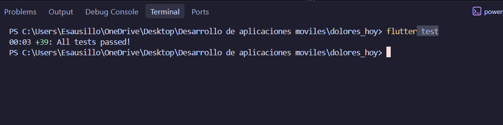
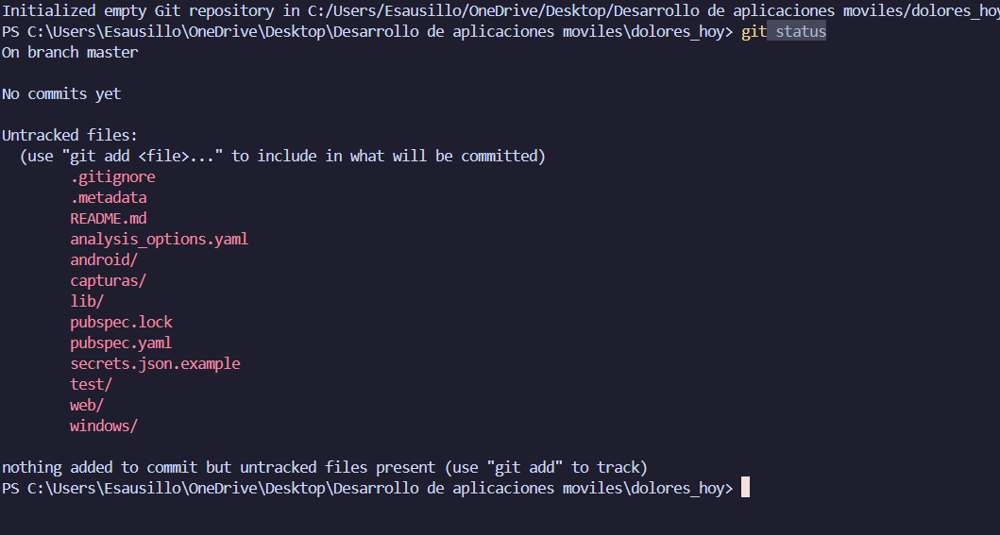
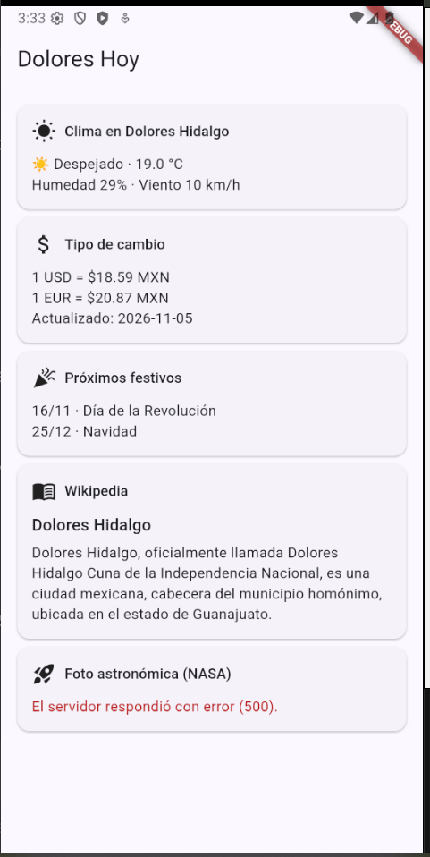
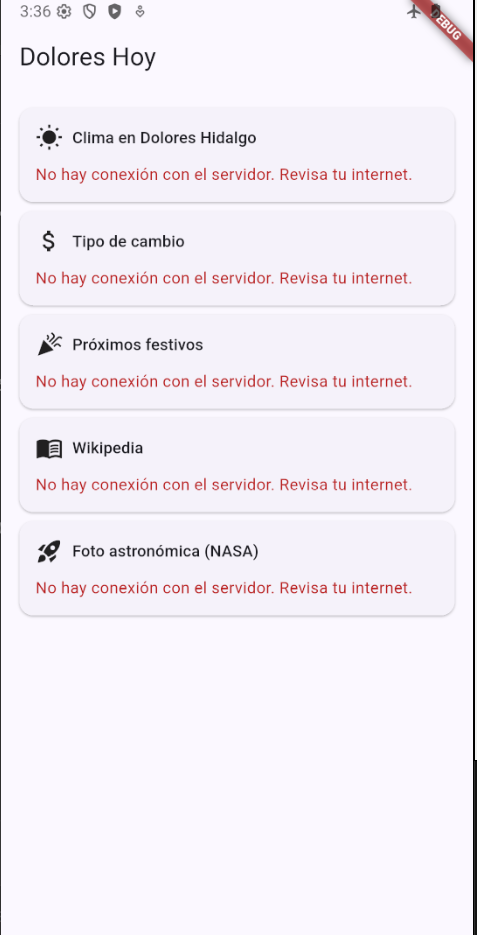
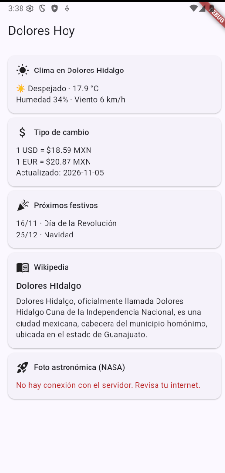

# Dolores Hoy

Tablero en Flutter que consume 5 APIs gratuitas aplicando buenas prácticas de seguridad, desarrollado con TDD.

**Materia:** Desarrollo Móvil Integral · UTNG
**Profesor:** Anastacio Rodríguez García
**Alumno:** TU NOMBRE COMPLETO
**Grupo / Matrícula:** TU GRUPO / TU MATRÍCULA

## Las 5 APIs

| # | API | Datos | Clave |
|---|---|---|---|
| 1 | Open-Meteo | Clima de Dolores Hidalgo | No |
| 2 | Frankfurter | Tipo de cambio MXN a USD y EUR | No |
| 3 | Nager.Date | Próximos días festivos de México | No |
| 4 | Wikipedia (es) | Resumen de un tema | No |
| 5 | NASA APOD | Foto astronómica del día | Sí |

## Estructura

```
dolores_hoy/
├── lib/
│   ├── dominio/         (excepciones.dart, modelos.dart)
│   ├── datos/           (cliente_seguro.dart, config_claves.dart, servicios.dart)
│   ├── presentacion/    (tablero_viewmodel.dart, pantalla_tablero.dart)
│   └── main.dart
├── test/                (ayudas, cliente_seguro_test, servicios_test,
│                         seguridad_test, tablero_viewmodel_test)
├── capturas/
├── secrets.json.example
└── pubspec.yaml
```

## Cómo ejecutar

1. Instalar dependencias: `flutter pub get`
2. Crear el archivo de claves a partir de la plantilla:
   `copy secrets.json.example secrets.json`
   y escribir en él la clave propia de https://api.nasa.gov (el archivo no se sube a git).
3. Correr las pruebas (sin internet): `flutter test`
4. Correr la app: `flutter run --dart-define-from-file=secrets.json`

## Evidencias

### Pruebas automáticas


### Seguridad: la clave no se sube al repositorio


### Tablero con las 5 APIs


### Resiliencia

**Sin internet:** las 5 tarjetas muestran un mensaje amable y la app no se cierra.



**Internet de regreso:** al recargar todo vuelve.




## Checklist de seguridad

- [x] Ninguna clave está en el código ni en el repositorio.
- [x] Todas las peticiones usan https y el cliente rechaza http.
- [x] Toda petición tiene timeout y límite de tamaño de respuesta.
- [x] Las direcciones se construyen con `Uri.https` y `pathSegments`.
- [x] Las entradas del usuario se validan (vacío, longitud, caracteres de control).
- [x] Las salidas del servidor se validan (tipos, `media_type`, URLs https).
- [x] Los logs usan `redactar()` y `ConfigClaves` no imprime la clave completa.
- [x] Los errores inesperados muestran un mensaje genérico.
- [x] Una API caída no afecta a las demás.